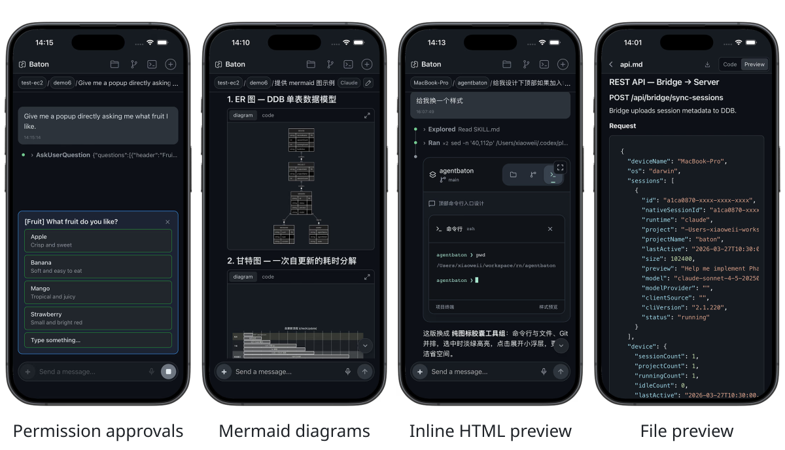

# <sub><picture><source media="(prefers-color-scheme: dark)" srcset="web/public/assets/baton-logo.svg"></picture></sub>Baton

[English](README.md) | [中文](README.zh-CN.md) | **Español**

Continúa en tu teléfono las tareas de [Claude Code](https://github.com/anthropics/claude-code), [Codex](https://openai.com/codex) y otros agentes de programación justo donde las dejaste en tu ordenador.

<p align="center">
  
</p>

Baton transmite y muestra en tiempo real, sin interferir en tu forma de trabajar, las Sessions de Claude Code, Codex, Pi, Hermes, OpenCode, Kiro y DeepSeek Harness en todos tus dispositivos. Todo va cifrado de extremo a extremo y tus conversaciones permanecen en tu propio ordenador.


## Inicio rápido

### 1. Instala el Bridge en tu ordenador

```bash
curl -fsSL https://agentbaton.app/install | bash
```

<details>
<summary>Windows</summary>

En PowerShell, con la opción **Ejecutar como administrador**:

```powershell
irm https://agentbaton.app/install.ps1 | iex
```

</details>

### 2. Descarga la App y conéctate

| iOS | Android | HarmonyOS | macOS | Windows | Linux |
|:---:|:---:|:---:|:---:|:---:|:---:|
|  |  |  |  |  |  |
| [TestFlight](https://testflight.apple.com/join/2HqQHD22) | [Baton.apk](https://dl.agentbaton.app/Baton.apk) | [Compilar e instalar](harmony/README.md) | [Baton.dmg](https://dl.agentbaton.app/Baton.dmg) | [Baton.exe](https://dl.agentbaton.app/Baton.exe) | [Baton.deb](https://dl.agentbaton.app/Baton.deb) |

Escanea el código QR que muestra el Bridge o pega su **Start URL**.

¿Prefieres tu propio servidor? [Despliégalo en AWS](#alojamiento-propio-aws).

---

## Funcionalidades

### Funciones principales

- **Siete agentes** — Claude Code, Codex, Pi, Hermes, OpenCode, Kiro y DeepSeek Harness en un único catálogo de Dispositivo → Proyecto → Session.
- **Transmisión en tiempo real** — las respuestas, el razonamiento y las llamadas a herramientas aparecen a medida que se generan.
- **Seguimiento de Sessions existentes** — sigue usando Claude Code y Codex en tu ordenador como siempre; un Bridge local ligero refleja el progreso en directo y los estados de ejecución, espera de entrada y finalización.
- **Interacción con Sessions existentes** — envía mensajes de seguimiento, incluso durante la ejecución, interrumpe tareas en curso y continúa el trabajo desde cualquier dispositivo conectado.
- **Creación de proyectos y Sessions** — crea un proyecto, inicia Sessions de Claude Code, Codex o agentes de Claude en segundo plano de forma remota y sigue supervisándolas tras desconectarte.
- **Permisos y preguntas** — aprueba o rechaza llamadas a herramientas, responde preguntas y revisa planes, incluidas las aprobaciones de comandos, archivos y MCP de Codex.
- **Comandos con barra y Skills** — autocompletado con `/` para los comandos integrados y personalizados de cada entorno, las Skills de Codex y los prompts guardados.
- **Codex Goals** — establece, pausa, reanuda o elimina objetivos de una conversación con `/goal` y sigue sus turnos de continuación autónoma en tiempo real.
- **Subagentes** — subagentes anidados de Claude Code y Codex agrupados bajo su Session principal, con estado en directo y una lista jerárquica de hilos.
- **Notificaciones móviles** — recibe avisos en iOS y Android cuando una Session termina o necesita tu intervención; toca el aviso para abrir la Session (los avisos de Android en el servicio alojado llegarán pronto).
- **Privacidad desde el diseño** — cifrado de extremo a extremo; las conversaciones permanecen en tu ordenador y el servidor solo las retransmite; usa el servicio alojado o despliégalo tú mismo en AWS.

### Herramientas de desarrollo

<p align="center">
  <picture><source media="(max-width: 600px)" srcset="docs/assets/showcase/project-files.avif" width="48%"></picture><picture><source media="(max-width: 600px)" srcset="docs/assets/showcase/empty.svg" width="2%" height="0"></picture><picture><source media="(max-width: 600px)" srcset="docs/assets/showcase/git.avif" width="48%"></picture><picture><source media="(max-width: 600px)" srcset="docs/assets/showcase/tools-mobile.svg" width="100%"></picture><picture><source media="(max-width: 600px)" srcset="docs/assets/showcase/terminal.avif" width="48%"></picture><picture><source media="(max-width: 600px)" srcset="docs/assets/showcase/empty.svg" width="2%" height="0"></picture><picture><source media="(max-width: 600px)" srcset="docs/assets/showcase/remote-preview.avif" width="48%"></picture><picture><source media="(max-width: 600px)" srcset="docs/assets/showcase/tools-mobile-second.svg"></picture>
</p>

- **Archivos del proyecto** — explora el código fuente con resaltado de líneas y descarga o comparte archivos mediante las funciones nativas del sistema.
- **Git** — revisa cambios, añade o retira archivos del área de preparación, descarta cambios, crea commits, envía cambios o publica una rama y explora el gráfico de ramas con diferencias históricas.
- **Terminales** — hasta cinco sesiones de shell por proyecto, compartidas en directo entre dispositivos y restauradas al volver, con una barra de teclas móvil, un control de dirección que repite las pulsaciones al mantenerlo presionado y acelera cuanto más lo arrastras, y desplazamiento suave con inercia (Bridge en macOS o Linux).
- **Vista previa de localhost** — abre `http://localhost:3000` (o cualquier puerto local) del ordenador donde se ejecuta el Bridge dentro de la App nativa, tocando un enlace de la Session o introduciendo el puerto, sin SSH, reenvío de puertos ni exposición pública.

### Visualización de contenido

<p align="center">
  <picture><source media="(max-width: 600px)" srcset="docs/assets/showcase/permissions.avif" width="48%"></picture><picture><source media="(max-width: 600px)" srcset="docs/assets/showcase/empty.svg" width="2%" height="0"></picture><picture><source media="(max-width: 600px)" srcset="docs/assets/showcase/mermaid.avif" width="48%"></picture><picture><source media="(max-width: 600px)" srcset="docs/assets/showcase/rendering-mobile.svg" width="100%"></picture><picture><source media="(max-width: 600px)" srcset="docs/assets/showcase/inline-html.avif" width="48%"></picture><picture><source media="(max-width: 600px)" srcset="docs/assets/showcase/empty.svg" width="2%" height="0"></picture><picture><source media="(max-width: 600px)" srcset="docs/assets/showcase/file-preview.avif" width="48%"></picture><picture><source media="(max-width: 600px)" srcset="docs/assets/showcase/rendering-mobile-second.svg"></picture>
</p>

- **Cronología de ejecución** — llamadas a herramientas y resultados plegables, con la salida completa disponible bajo demanda.
- **Diferencias, Mermaid y LaTeX** — se muestran integrados mientras se recibe la respuesta; copia el código fuente y descarga como imágenes.
- **HTML integrado en las conversaciones** — vistas previas interactivas que se pueden ampliar a pantalla completa sin perder su estado.
- **Vista previa de archivos** — archivos Markdown, HTML, PDF, Office, imágenes y vídeos de proyectos o mensajes; las páginas HTML cargan sus CSS, scripts e imágenes con rutas relativas y se muestran completas sin un servidor local; las imágenes de los mensajes se muestran integradas y se pueden abrir a pantalla completa y ampliar con dos dedos.

### Rápido, estable y ligero

- **Experiencia de App nativa** — la pantalla de inicio nativa da paso sin interrupciones a las pantallas de carga de cada etapa, sin destellos blancos; al deslizar desde el borde para volver, se revela la página anterior.
- **Temas claro y oscuro** — elige Sistema, Claro u Oscuro en Ajustes; la interfaz, el código, los diagramas y la apariencia nativa cambian juntos.
- **Tamaño de página ajustable** — cambia el tamaño de letra en el móvil o usa los atajos de zoom en el escritorio; la elección se conserva entre páginas y al reiniciar la App.
- **Carga instantánea** — las listas, el historial y los datos del proyecto se abren desde la caché local y se actualizan en segundo plano.
- **Entrega estable** — la transmisión ordenada, la reconexión automática y la cola de envíos mantienen la continuidad de las Sessions con redes móviles inestables y después de pasar la App a segundo plano.
- **Apps ligeras** — paquetes nativos pequeños basados en Tauri, además de una App contenedora con ArkWeb para HarmonyOS NEXT.
- **Bridge sin mantenimiento** — funciona de forma permanente en macOS, Linux y Windows, conecta varios ordenadores a una cuenta y se actualiza automáticamente.

### Más funciones

- **Entrada de archivos, imágenes y voz** — adjunta archivos, arrastra archivos o imágenes en el escritorio, envía imágenes comprimidas y dicta mensajes en iOS.
- **Borradores de Session** — conserva el texto y los archivos adjuntos ya subidos al cambiar de Session o volver a abrir la App en el mismo dispositivo.
- **Gestión de Sessions** — cambia el nombre de las Sessions mediante su entorno nativo y mantén pulsado para seleccionar y eliminar varias Sessions o proyectos, con la opción de eliminar también sus archivos locales.
- **Emparejamiento y dispositivos** — añade ordenadores y teléfonos con un código QR, elimina un dispositivo (lo que sustituye la clave de cifrado) y recupera tu cuenta con una frase de recuperación.
- **Rotación de la clave API** — cambia la clave API con `--rotate-key` y conserva los datos existentes.
- **Pestañas en macOS** — trabaja en varias Sessions mediante pestañas independientes.
- **Estadísticas de uso de Claude** — consulta el estado, la configuración, los límites de uso, el historial de tokens y los gráficos de uso de modelos.

---

## Arquitectura

```
┌────────────────┐               ┌──────────────────────┐               ┌──────────────────┐
│     Bridge     │ ◀────WS─────▶ │        Relay         │ ◀────WS─────▶ │     App/Web      │
│ (local hosts)  │               │                      │               │  (phone/desktop) │
└────────────────┘               └──────────┬───────────┘               └──────────────────┘
                                            │
                                            ▼
                                 ┌──────────────────────┐
                                 │ accounts + devices,  │
                                 │ 1-day file transfer  │
                                 └──────────────────────┘
```

El **Bridge** descubre las Sessions de los agentes, normaliza sus eventos, conserva las relaciones entre agentes principales y subagentes y gestiona el control local de agentes, los archivos del proyecto, los comandos de Git y los procesos de terminal. El **Relay** autentica los dispositivos de una misma cuenta y retransmite sus mensajes cifrados de extremo a extremo; solo guarda los registros de cuentas, dispositivos y tokens (las Sessions permanecen en tu ordenador) y una zona de tránsito de archivos que se conserva 1 día. La **App/Web** carga el historial en caché, se suscribe a las actualizaciones de las Sessions y los agentes raíz, agrupa los hilos anidados bajo la Session principal y envía las acciones del usuario al entorno local correspondiente.

---

## Alojamiento propio (AWS)

Ejecuta tu propio servidor en tu cuenta de AWS en lugar de usar el servicio alojado.

### 1. Desplegar el servidor

Requiere [AWS CLI](https://docs.aws.amazon.com/cli/latest/userguide/getting-started-install.html) con permisos para crear pilas de CloudFormation.

```bash
curl -fsSL https://raw.githubusercontent.com/agentbaton/baton/main/server/install.sh | bash
```

Tarda unos 6–8 minutos. Al finalizar, muestra una **Start URL** y un código QR. Admite las opciones `--region`, `--stack` y `--profile` (añádelas después de `bash -s --`).


### 2. Instalar el Bridge

1. Abre la **Start URL** en tu navegador (también sirve como visor web).
2. Copia el comando de una línea **Install bridge** de la página Setup.
3. Ejecútalo en el ordenador donde se esté ejecutando Claude Code o Codex.

En Windows, ejecuta el comando de instalación en PowerShell con la opción **Ejecutar como administrador**.

Después, descarga la App indicada arriba y escanea el código QR o introduce la Start URL.

---

## ¿Por qué Baton?

Baton alude tanto al testigo de una carrera de relevos como a la batuta de un director de orquesta: te permite retomar el trabajo en otro dispositivo y dirigir a tus agentes a distancia.

---

## Desinstalación

Consulta la [guía de desinstalación](scripts/uninstall/README.md).

---

## Licencia

MIT
