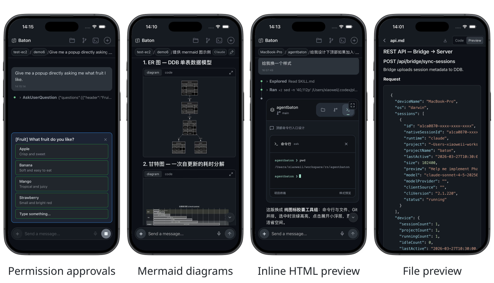

# <sub><picture><source media="(prefers-color-scheme: dark)" srcset="web/public/assets/baton-logo.svg"></picture></sub>Baton

**English** | [中文](README.zh-CN.md) | [Español](README.es-ES.md)

Pick up your [Claude Code](https://github.com/anthropics/claude-code), [Codex](https://openai.com/codex) and other coding-agent tasks on your phone, right where you left off on your computer.

<p align="center">
  
</p>

Baton provides non-intrusive, real-time streaming and rendering for Claude Code, Codex, Pi, Hermes, OpenCode, Kiro and DeepSeek Harness sessions across your devices. Everything is end-to-end encrypted and your conversations stay on your own computer.


## Quick Start

### Option A: Baton-hosted relay

#### 1. Install Bridge on your computer

```bash
curl -fsSL https://agentbaton.app/install | bash
```

<details>
<summary>Windows</summary>

In PowerShell, using **Run as administrator**:

```powershell
irm https://agentbaton.app/install.ps1 | iex
```

</details>

#### 2. Get the App and connect

| iOS | Android | HarmonyOS | macOS | Windows | Linux |
|:---:|:---:|:---:|:---:|:---:|:---:|
|  |  |  |  |  |  |
| [TestFlight](https://testflight.apple.com/join/2HqQHD22) | [Baton.apk](https://dl.agentbaton.app/Baton.apk) | [Build & install](harmony/README.md) | [Baton.dmg](https://dl.agentbaton.app/Baton.dmg) | [Baton.exe](https://dl.agentbaton.app/Baton.exe) | [Baton.deb](https://dl.agentbaton.app/Baton.deb) |

Scan the QR code shown by Bridge, or paste its **Start URL**.

### Option B: Self-hosted relay on AWS

<details>
<summary>Deployment steps</summary>

**1. Deploy Server**

Requires [AWS CLI](https://docs.aws.amazon.com/cli/latest/userguide/getting-started-install.html) with permissions to create CloudFormation stacks, plus `git`, `zip` and `openssl`.

```bash
curl -fsSL https://raw.githubusercontent.com/agentbaton/baton/main/server/install.sh | bash
```

Takes ~6-8 minutes. Prints a **Start URL** (and a QR code when Node.js is installed) on success. Supports `--region`, `--stack`, `--profile` options (pass after `bash -s --`).

**2. Install Bridge**

1. Open the **Start URL** in your browser (this is also the web viewer)
2. Copy the one-line **Install bridge** command from the Setup page
3. Run it on the computer where you use your coding agent.

On native Windows, run the install command in PowerShell using **Run as administrator**.

Then get the App above and scan the QR code or input the Start URL.

</details>

---

## Features

### Core

- **Popular agents** — Claude Code, Codex, Pi, Hermes, OpenCode, Kiro and DeepSeek Harness, all in one list
- **Two-way handoff** — sessions on your computer stream live to your phone, with running / needs input / done status; start projects and sessions on your phone and carry on at your computer
- **Approvals and questions** — approve or deny tool calls, answer questions and review plans from your phone
- **Notifications** — get an alert when a session finishes or needs you; tap to open it
- **End-to-end encrypted chat** — your computer stores your chat history; the relay forwards messages without storing them

### Developer tools

<p align="center">
  <picture><source media="(max-width: 600px)" srcset="docs/assets/showcase/project-files.avif" width="48%"></picture><picture><source media="(max-width: 600px)" srcset="docs/assets/showcase/empty.svg" width="2%" height="0"></picture><picture><source media="(max-width: 600px)" srcset="docs/assets/showcase/git.avif" width="48%"></picture><picture><source media="(max-width: 600px)" srcset="docs/assets/showcase/tools-mobile.svg" width="100%"></picture><picture><source media="(max-width: 600px)" srcset="docs/assets/showcase/terminal.avif" width="48%"></picture><picture><source media="(max-width: 600px)" srcset="docs/assets/showcase/empty.svg" width="2%" height="0"></picture><picture><source media="(max-width: 600px)" srcset="docs/assets/showcase/remote-preview.avif" width="48%"></picture><picture><source media="(max-width: 600px)" srcset="docs/assets/showcase/tools-mobile-second.svg"></picture>
</p>

- **Project files** — browse source with line highlighting, and download or share files natively
- **Git** — review changes, stage / unstage / discard files, commit, push or publish a branch, and browse a branch graph with historical diffs
- **Terminals** — up to five shells per project, shared live across devices and restored when you return, with a mobile keybar, a long-press arrow joystick that auto-repeats faster the farther you drag, and smooth momentum scrolling
- **Localhost previews** — open the Bridge machine's `http://localhost:3000` (or any local port) inside the native App by tapping a session link or entering the port, with no SSH, port forwarding, or public exposure

### Rich rendering

<p align="center">
  <picture><source media="(max-width: 600px)" srcset="docs/assets/showcase/permissions.avif" width="48%"></picture><picture><source media="(max-width: 600px)" srcset="docs/assets/showcase/empty.svg" width="2%" height="0"></picture><picture><source media="(max-width: 600px)" srcset="docs/assets/showcase/mermaid.avif" width="48%"></picture><picture><source media="(max-width: 600px)" srcset="docs/assets/showcase/rendering-mobile.svg" width="100%"></picture><picture><source media="(max-width: 600px)" srcset="docs/assets/showcase/inline-html.avif" width="48%"></picture><picture><source media="(max-width: 600px)" srcset="docs/assets/showcase/empty.svg" width="2%" height="0"></picture><picture><source media="(max-width: 600px)" srcset="docs/assets/showcase/file-preview.avif" width="48%"></picture><picture><source media="(max-width: 600px)" srcset="docs/assets/showcase/rendering-mobile-second.svg"></picture>
</p>

- **Execution timeline** — collapsible tool calls and results, with full output loaded on demand
- **Diffs, Mermaid, and LaTeX** — rendered inline while streaming; copy source and download as images
- **Inline HTML in conversations** — interactive previews, expandable to full screen without losing their state
- **File previews** — Markdown, HTML, PDF, Office, image, and video files from projects or messages; HTML pages load their relative CSS, scripts, and images, so they render fully without a local server; images in messages display inline and open full screen with pinch-to-zoom

### Fast, stable, lightweight

- **Native-like App** — the native splash hands off seamlessly to matching skeleton screens at every stage with no white flash, and edge-swipe back reveals the previous page underneath
- **Light and dark themes** — choose System, Light, or Dark in Settings; the interface, code, diagrams, and native app appearance update together
- **Adjustable page size** — change font size on mobile or use desktop zoom shortcuts; your choice persists across pages and app restarts
- **Instant loading** — lists, history, and project data open from local page caches, then refresh in the background
- **Real-time streaming** — responses, thinking, and tool calls appear as they are generated
- **Stable delivery** — ordered streaming, automatic reconnect, and queued sends keep sessions intact on flaky mobile networks and after backgrounding the App
- **Lightweight Apps** — small Tauri-based native packages, plus an ArkWeb shell for HarmonyOS NEXT
- **Zero-maintenance Bridge** — runs always-on across macOS, Linux, and Windows, connects multiple computers to one account, and updates itself

### More

- **Steer running sessions** — send follow-ups mid-turn or interrupt a running turn
- **Slash commands and Skills** — `/` autocomplete for each agent's built-in and custom commands, Skills, and saved prompts
- **Subagents** — subagents grouped under their main session, with live status
- **Claude background agents** — start them remotely and keep following them after you detach
- **File, image, and voice input** — attach files, drag and drop files or images on desktop, send compressed images, and dictate messages on iOS
- **Session drafts** — keep text and uploaded attachments when switching sessions or reopening the App on the same device
- **Session management** — rename sessions through their native runtime, and long-press to multi-select and delete sessions or projects, optionally removing their local files
- **Pairing and devices** — add computers and phones by QR code, remove a device (which replaces the encryption key), and recover your account with a recovery phrase
- **API key rotation** — rotate the API key with `--rotate-key` while preserving existing data
- **macOS tabs** — work on multiple sessions in independent tabs
- **Claude usage insights** — status, settings, rate limits, token history, and model usage charts

---

## Architecture

```
┌────────────────┐               ┌──────────────────────┐               ┌──────────────────┐
│     Bridge     │ ◀────WS─────▶ │        Relay         │ ◀────WS─────▶ │     App/Web      │
│ (local hosts)  │               │ API Gateway + Lambda │               │  (phone/desktop) │
└────────────────┘               └──────────┬───────────┘               └──────────────────┘
                                            │
                                            ▼
                                 ┌──────────────────────┐
                                 │ accounts + devices,  │
                                 │ file transfer area   │
                                 └──────────────────────┘
```

- **Bridge** discovers agent sessions, normalizes their events, preserves main/subagent relationships, and handles local agent control, project files, Git commands, and terminal processes.
- **Relay** authenticates the devices of one account and forwards their end-to-end encrypted messages; it keeps only account, device and token records (sessions stay on your computer) and a temporary transfer area for files.
- **App/Web** loads cached history, subscribes to session and root-agent updates, aggregates nested threads under the main session, and routes user actions back to the correct local runtime.

---

## Why Baton?

Named after both a relay baton and a conductor's baton, Baton lets you pick up work on another device and direct your agents remotely.

---

## Uninstall

### Hosted relay

- **Move a computer to another account**: run `node ~/.baton-bridge/bridge.mjs leave` on it.
- **Remove a computer**: long-press it on the App's home page and choose **Remove**; its Bridge stops and turns off autostart.
- **Delete the account**: **Settings** → **Delete account**.

### Self-hosted relay

Remove every computer, then delete the CloudFormation stack.

To delete Bridge's files as well, see the [uninstall guide](scripts/uninstall/README.md).

---

## License

MIT
