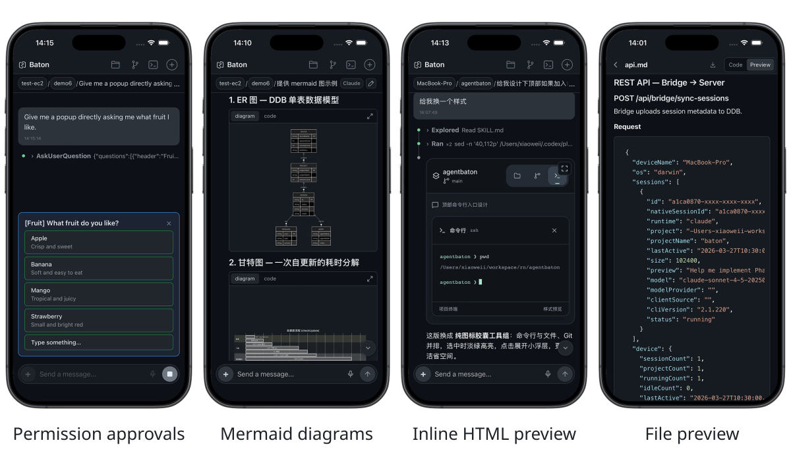
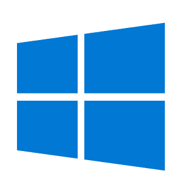

# <sub><picture><source media="(prefers-color-scheme: dark)" srcset="web/public/assets/baton-logo.svg"></picture></sub>Baton

**English** | [中文](README.zh-CN.md)

Pick up your [Claude Code](https://github.com/anthropics/claude-code) and [Codex](https://openai.com/codex) tasks on your phone, right where you left off on your computer.

<p align="center">
  
</p>

Baton provides non-intrusive, real-time streaming and rendering for Claude Code and Codex sessions across your devices. Your session data stays in your own AWS account.


### Developer tools

<p align="center">
  <picture><source media="(max-width: 600px)" srcset="docs/assets/showcase/project-files.avif" width="48%"></picture><picture><source media="(max-width: 600px)" srcset="docs/assets/showcase/empty.svg" width="2%" height="0"></picture><picture><source media="(max-width: 600px)" srcset="docs/assets/showcase/git.avif" width="48%"></picture><picture><source media="(max-width: 600px)" srcset="docs/assets/showcase/tools-mobile.svg" width="100%"></picture><picture><source media="(max-width: 600px)" srcset="docs/assets/showcase/terminal.avif" width="48%"></picture><picture><source media="(max-width: 600px)" srcset="docs/assets/showcase/empty.svg" width="2%" height="0"></picture><picture><source media="(max-width: 600px)" srcset="docs/assets/showcase/remote-preview.avif" width="48%"></picture><picture><source media="(max-width: 600px)" srcset="docs/assets/showcase/tools-mobile-second.svg"></picture>
</p>

### Rich rendering

<p align="center">
  <picture><source media="(max-width: 600px)" srcset="docs/assets/showcase/permissions.avif" width="48%"></picture><picture><source media="(max-width: 600px)" srcset="docs/assets/showcase/empty.svg" width="2%" height="0"></picture><picture><source media="(max-width: 600px)" srcset="docs/assets/showcase/mermaid.avif" width="48%"></picture><picture><source media="(max-width: 600px)" srcset="docs/assets/showcase/rendering-mobile.svg" width="100%"></picture><picture><source media="(max-width: 600px)" srcset="docs/assets/showcase/inline-html.avif" width="48%"></picture><picture><source media="(max-width: 600px)" srcset="docs/assets/showcase/empty.svg" width="2%" height="0"></picture><picture><source media="(max-width: 600px)" srcset="docs/assets/showcase/file-preview.avif" width="48%"></picture><picture><source media="(max-width: 600px)" srcset="docs/assets/showcase/rendering-mobile-second.svg"></picture>
</p>

---

## Quick Start

### 1. Deploy Server

Requires [AWS CLI](https://docs.aws.amazon.com/cli/latest/userguide/getting-started-install.html) with permissions to create CloudFormation stacks.

```bash
curl -fsSL https://raw.githubusercontent.com/zhu-xiaowei/baton/main/server/install.sh | bash
```

Takes ~6-8 minutes. Prints a **Start URL** and QR code on success. Supports `--region`, `--stack`, `--profile` options (pass after `bash -s --`).


### 2. Install Bridge

Requires [Node.js](https://nodejs.org/) 20.9+.

1. Open the **Start URL** in your browser (this is also the web viewer)
2. Copy the one-line **Install bridge** command from the Setup page
3. Run it on the machine where Claude Code or Codex is running

On native Windows, run the install command in PowerShell using **Run as administrator**.

### 3. Download App

| iOS | Android | HarmonyOS | macOS | Windows |
|:---:|:---:|:---:|:---:|:---:|
|  |  |  |  |  |
| [TestFlight](https://testflight.apple.com/join/UekStGCA) | [Baton.apk](https://github.com/zhu-xiaowei/baton/releases/download/v1.0.0/Baton.apk) | [Build & install](harmony/README.md) | [Baton.dmg](https://github.com/zhu-xiaowei/baton/releases/download/v1.0.0/Baton.dmg) | [Baton.exe](https://github.com/zhu-xiaowei/baton/releases/download/v1.0.0/Baton.exe) |

After downloading the app, scan the QR code or input the Start URL to get started.

---

## Features

### Core

- **Claude Code and Codex** — both runtimes in one Device → Project → Session catalog
- **Real-time streaming** — responses, thinking, and tool calls appear as they are generated
- **Follow existing sessions** — keep using Claude Code and Codex on your computer as usual; a lightweight local Bridge mirrors live progress and running / needs input / done status
- **Interact with existing sessions** — send follow-ups, even mid-turn, interrupt running turns, and continue work from any connected device
- **Create projects and sessions** — create a new project, start Claude Code, Codex, or Claude background-agent sessions remotely, and keep monitoring them after detaching
- **Permissions and questions** — approve or deny tool calls, answer questions, and review plans, including Codex command, file, and MCP approvals
- **Slash commands and Skills** — `/` autocomplete for each runtime's built-in and custom commands, Codex Skills, and saved prompts
- **Codex Goals** — set, pause, resume, or clear thread goals with `/goal`, and follow autonomous continuation turns in real time
- **Subagents** — nested Claude Code and Codex subagents grouped under their main session, with live status and a hierarchical thread list
- **Your own infrastructure** — one-command deploy to your AWS account; session data never leaves it

### Developer tools

- **Project files** — browse source with line highlighting, and download or share files natively
- **Git** — review changes, stage / unstage / discard files, commit, push or publish a branch, and browse a branch graph with historical diffs
- **Terminals** — up to five shells per project, shared live across devices and restored when you return, with a mobile keybar, a long-press arrow joystick that auto-repeats faster the farther you drag, and smooth momentum scrolling (macOS / Linux Bridge)
- **Localhost previews** — open the Bridge machine's `http://localhost:3000` (or any local port) inside the native App by tapping a session link or entering the port, with no SSH, port forwarding, or public exposure

### Fast, stable, lightweight

- **Native-like App** — the native splash hands off seamlessly to matching skeleton screens at every stage with no white flash, and edge-swipe back reveals the previous page underneath
- **Instant loading** — lists, history, and project data open from local page caches, then refresh in the background
- **Stable delivery** — ordered streaming, automatic reconnect, and queued sends keep sessions intact on flaky mobile networks and after backgrounding the App
- **Lightweight Apps** — small Tauri-based native packages, plus an ArkWeb shell for HarmonyOS NEXT
- **Zero-maintenance Bridge** — runs always-on across macOS, Linux, and Windows, connects multiple computers to one account, and updates itself

### Rich rendering

- **Execution timeline** — collapsible tool calls and results, with full output loaded on demand
- **Diffs, Mermaid, and LaTeX** — rendered inline while streaming
- **Inline HTML in conversations** — interactive previews, expandable to full screen without losing their state
- **File previews** — Markdown, HTML, PDF, Office, image, and video files from projects or messages; HTML pages load their relative CSS, scripts, and images, so they render fully without a local server; images in messages display inline and open full screen with pinch-to-zoom

### More

- **File, image, and voice input** — attach files, send compressed images, and dictate messages on iOS
- **Session drafts** — keep text and uploaded attachments when switching sessions or reopening the App on the same device
- **Session management** — rename sessions through their native runtime, and long-press to multi-select and delete sessions or projects, optionally removing their local files
- **Device management** — remove devices from Baton and stop their online Bridges while keeping local session files
- **API key rotation** — rotate the API key with `--rotate-key` while preserving existing data
- **macOS tabs** — work on multiple sessions in independent tabs
- **Claude usage insights** — status, settings, rate limits, token history, and model usage charts

---

## Architecture

```
┌────────────────┐               ┌────────────────┐               ┌──────────────────┐
│     Bridge     │ ◀────WS─────▶ │     Server     │ ◀────WS─────▶ │     App/Web      │
│ (local hosts)  │               │  (AWS APIs)    │               │  (phone/desktop) │
└────────────────┘               └───────┬────────┘               └──────────────────┘
                                         │
                                         ▼
                                 ┌────────────────┐
                                 │ DynamoDB + S3  │
                                 │ (data + media) │
                                 └────────────────┘
```

**Bridge** discovers Claude Code and Codex sessions, normalizes their events, preserves main/subagent relationships, and handles local agent control, project files, Git commands, and terminal processes. **Server** authenticates and routes control messages, stores session and root-thread data in DynamoDB, and serves synced media through S3. **App/Web** loads cached history, subscribes to session and root-agent updates, aggregates nested threads under the main session, and routes user actions back to the correct local runtime.

---

## Why Baton?

Named after both a relay baton and a conductor's baton, Baton lets you pick up work on another device and direct your agents remotely.

---

## Uninstall

See the [uninstall guide](scripts/uninstall/README.md).

---

## License

MIT
