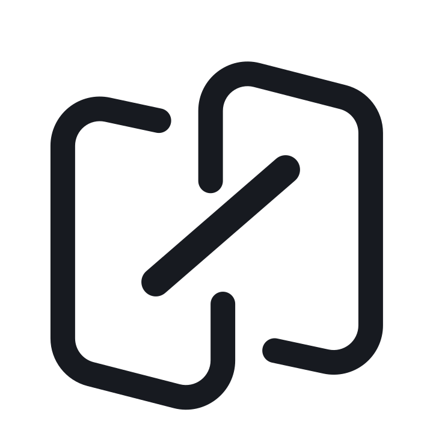
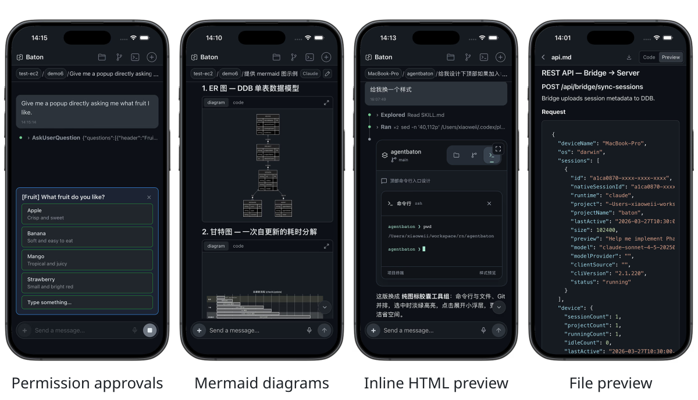

# <sub><picture><source media="(prefers-color-scheme: dark)" srcset="web/public/assets/baton-logo.svg"></picture></sub>Baton

[English](README.md) | **中文** | [Español](README.es-ES.md)

在手机上接着处理电脑上的 [Claude Code](https://github.com/anthropics/claude-code)、[Codex](https://openai.com/codex) 等编程代理任务，无缝延续工作进度。

<p align="center">
  
</p>

Baton 以无侵入的方式，在多个设备上实时同步和渲染 Claude Code、Codex、Pi、Hermes、OpenCode、Kiro 和 DeepSeek Harness 的 Session。所有内容均端到端加密，对话始终保存在你自己的电脑上。


## 快速开始

### 方案 A：Baton 官方中继

#### 1. 在电脑上安装 Bridge

```bash
curl -fsSL https://agentbaton.app/install | bash
```

<details>
<summary>Windows</summary>

以**管理员身份运行** PowerShell，然后执行：

```powershell
irm https://agentbaton.app/install.ps1 | iex
```

</details>

#### 2. 下载 App 并连接

| iOS | Android | HarmonyOS | macOS | Windows | Linux |
|:---:|:---:|:---:|:---:|:---:|:---:|
|  |  |  |  |  |  |
| [TestFlight](https://testflight.apple.com/join/2HqQHD22) | [Baton.apk](https://dl.agentbaton.app/Baton.apk) | [构建与安装](harmony/README.zh-CN.md) | [Baton.dmg](https://dl.agentbaton.app/Baton.dmg) | [Baton.exe](https://dl.agentbaton.app/Baton.exe) | [Baton.deb](https://dl.agentbaton.app/Baton.deb) |

扫描 Bridge 显示的二维码，或粘贴 **Start URL** 连接。

### 方案 B：AWS 自建中继

<details>
<summary>查看部署步骤</summary>

**1. 部署服务器**

需要安装 [AWS CLI](https://docs.aws.amazon.com/cli/latest/userguide/getting-started-install.html)，并具备创建 CloudFormation 堆栈的权限；另需 `git`、`zip` 和 `openssl`。

```bash
curl -fsSL https://raw.githubusercontent.com/agentbaton/baton/main/server/install.sh | bash
```

部署约需 6–8 分钟，成功后会输出 **Start URL**（装有 Node.js 时还会输出二维码）。支持 `--region`、`--stack`、`--profile` 选项（通过 `bash -s --` 传入）。

**2. 安装 Bridge**

1. 在浏览器中打开 **Start URL**（也可直接作为 Web 查看器使用）。
2. 在 Setup 页面复制 **Install bridge** 提供的一行安装命令。
3. 在你使用编程助手的电脑上执行该命令。

如果直接在 Windows 上安装，请以**管理员身份运行** PowerShell，再执行安装命令。

然后下载上方的 App，扫描二维码或输入 Start URL。

</details>

---

## 功能

### 核心功能

- **主流 Agent** — Claude Code、Codex、Pi、Hermes、OpenCode、Kiro、DeepSeek Harness，统一在一个列表里。
- **双向接力** — 电脑上的 Session 实时同步到手机，并显示运行中、等待输入、已完成状态；在手机上新建项目和 Session，回到电脑也能接着用。
- **审批与回答** — 在手机上批准或拒绝工具调用、回答问题、审阅计划。
- **通知提醒** — Session 完成或需要你处理时提醒你，点一下就能打开。
- **端到端加密聊天** — 聊天记录保存在你的电脑上，中继只转发消息，不保存记录。

### 开发工具

<p align="center">
  <picture><source media="(max-width: 600px)" srcset="docs/assets/showcase/project-files.avif" width="48%"></picture><picture><source media="(max-width: 600px)" srcset="docs/assets/showcase/empty.svg" width="2%" height="0"></picture><picture><source media="(max-width: 600px)" srcset="docs/assets/showcase/git.avif" width="48%"></picture><picture><source media="(max-width: 600px)" srcset="docs/assets/showcase/tools-mobile.svg" width="100%"></picture><picture><source media="(max-width: 600px)" srcset="docs/assets/showcase/terminal.avif" width="48%"></picture><picture><source media="(max-width: 600px)" srcset="docs/assets/showcase/empty.svg" width="2%" height="0"></picture><picture><source media="(max-width: 600px)" srcset="docs/assets/showcase/remote-preview.avif" width="48%"></picture><picture><source media="(max-width: 600px)" srcset="docs/assets/showcase/tools-mobile-second.svg"></picture>
</p>

- **项目文件** — 浏览源码并高亮指定行，使用系统原生功能下载或分享文件。
- **Git** — 查看变更，暂存、取消暂存或丢弃文件变更，提交、推送或发布分支，并通过分支图浏览历史差异。
- **终端** — 每个项目最多支持五个 Shell，跨设备实时共享，返回时恢复；提供移动端快捷键栏、长按方向键摇杆（拖动越远，重复越快）和平滑惯性滚动。
- **本地服务预览** — 点击 Session 中的链接或输入端口，即可在原生 App 中打开 Bridge 所在电脑的 `http://localhost:3000` 或其他本地端口，无需 SSH、端口转发或暴露公网。

### 丰富的内容展示

<p align="center">
  <picture><source media="(max-width: 600px)" srcset="docs/assets/showcase/permissions.avif" width="48%"></picture><picture><source media="(max-width: 600px)" srcset="docs/assets/showcase/empty.svg" width="2%" height="0"></picture><picture><source media="(max-width: 600px)" srcset="docs/assets/showcase/mermaid.avif" width="48%"></picture><picture><source media="(max-width: 600px)" srcset="docs/assets/showcase/rendering-mobile.svg" width="100%"></picture><picture><source media="(max-width: 600px)" srcset="docs/assets/showcase/inline-html.avif" width="48%"></picture><picture><source media="(max-width: 600px)" srcset="docs/assets/showcase/empty.svg" width="2%" height="0"></picture><picture><source media="(max-width: 600px)" srcset="docs/assets/showcase/file-preview.avif" width="48%"></picture><picture><source media="(max-width: 600px)" srcset="docs/assets/showcase/rendering-mobile-second.svg"></picture>
</p>

- **执行时间线** — 工具调用与结果可折叠，完整输出按需加载。
- **差异、Mermaid 和 LaTeX** — 在实时输出过程中直接渲染，可复制源码及下载为图片。
- **对话内嵌 HTML** — 支持交互式预览，可展开至全屏并保留当前状态。
- **文件预览** — 预览项目或消息中的 Markdown、HTML、PDF、Office、图片和视频文件；HTML 页面会加载相对路径的 CSS、脚本和图片，无需本地服务器即可完整显示；消息中的图片直接展示，支持全屏打开和双指缩放。

### 快速、稳定、轻量

- **接近原生的 App 体验** — 原生启动画面与各阶段的骨架屏无缝衔接，无白屏闪烁；从屏幕边缘滑动返回时，可看到下层页面。
- **浅色与深色主题** — 在设置中选择跟随系统、浅色或深色，界面、代码、图表和原生 App 外观同步切换。
- **页面大小调节** — 移动端可调整字号，桌面端可使用缩放快捷键；设置在切换页面和重启 App 后保留。
- **即时加载** — 列表、历史记录和项目数据先从本地页面缓存加载，再在后台刷新。
- **实时输出** — 回复、思考过程和工具调用随生成过程实时显示。
- **稳定传输** — 有序传输、自动重连和消息发送队列，让 Session 在移动网络不稳定或 App 切换到后台后仍能保持连贯。
- **轻量 App** — 基于 Tauri 构建的小体积原生安装包，以及适用于 HarmonyOS NEXT 的 ArkWeb 壳。
- **免维护 Bridge** — 支持 macOS、Linux 和 Windows 常驻运行，可将多台电脑连接到同一账户，并自动更新。

### 更多功能

- **随时介入** — 在回复过程中追加消息，或中断正在执行的任务。
- **斜杠命令与 Skills** — 输入 `/` 自动补全各 Agent 的内置命令、自定义命令、Skills 和已保存的提示词。
- **子代理** — 子代理归入主 Session，并显示实时状态。
- **Claude 后台代理** — 远程启动，断开连接后仍可继续跟踪。
- **文件、图片与语音输入** — 添加文件附件，在桌面端拖入文件或图片，发送压缩图片，并在 iOS 上通过语音输入消息。
- **Session 草稿** — 在同一设备上切换 Session 或重新打开 App 时，保留文字和已上传的附件。
- **Session 管理** — 通过对应运行环境的原生能力重命名 Session，长按可多选并删除 Session 或项目，也可同时删除本地文件。
- **配对与设备** — 通过二维码添加电脑和手机，移除设备（同时更换加密密钥），并可使用恢复短语找回账户。
- **API key 轮换** — 支持通过 `--rotate-key` 轮换 API key，保留已有数据。
- **macOS 标签页** — 通过独立标签页同时处理多个 Session。
- **Claude 用量分析** — 查看状态、设置、速率限制、Token 历史和模型用量图表。

---

## 架构

```
┌────────────────┐               ┌──────────────────────┐               ┌──────────────────┐
│     Bridge     │ ◀────WS─────▶ │        Relay         │ ◀────WS─────▶ │     App/Web      │
│ (local hosts)  │               │ API Gateway + Lambda │               │  (phone/desktop) │
└────────────────┘               └──────────┬───────────┘               └──────────────────┘
                                            │
                                            ▼
                                 ┌──────────────────────┐
                                 │ accounts + devices,  │
                                 │ file transfer area   │
                                 └──────────────────────┘
```

- **Bridge** 在本地电脑上发现代理 Session，统一事件格式，保留主代理与子代理的关系，并处理本地代理控制、项目文件、Git 命令和终端进程。
- **Relay** 对同一账户下的设备进行身份验证，并转发它们之间端到端加密的消息；它只保存账户、设备和令牌记录（Session 留在你的电脑上），以及临时的文件中转区。
- **App/Web** 加载缓存的历史记录，订阅 Session 和根代理更新，将嵌套线程归入主 Session，并把用户操作发送给对应的本地运行环境。

---

## 为什么叫 Baton？

Baton 既是接力棒，也是指挥棒：你可以在另一台设备上接着工作，也可以远程指挥你的代理。

---

## 卸载

### 托管中继

- **把电脑换到另一个账户**：在这台电脑上运行 `node ~/.baton-bridge/bridge.mjs leave`。
- **移除一台电脑**：在 App 首页长按这台电脑，选择 **Remove**；它的 Bridge 会停止运行并关闭开机自启。
- **删除账户**：**Settings** → **Delete account**。

### 自建中继

先移除所有电脑，再删除 CloudFormation 堆栈。

如需同时删除 Bridge 的文件，参见[卸载指南](scripts/uninstall/README.md)。

---

## 许可证

MIT
