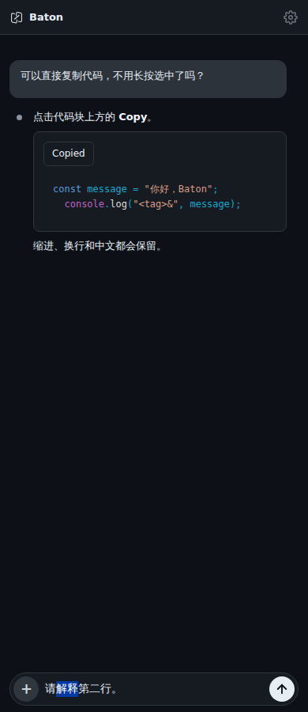
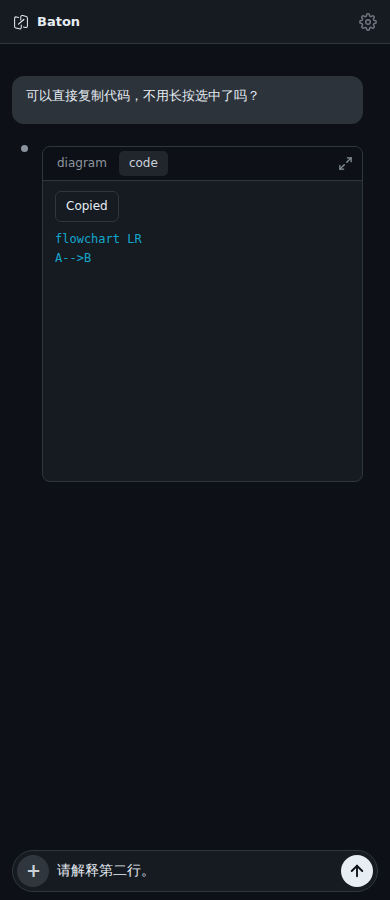

# Copy code from chat

Assistant code blocks have a **Copy** button above the code. It copies only that
block's displayed code, including indentation, line breaks and Unicode. Syntax
highlighting, surrounding prose and button labels are excluded. Mermaid's Code
tab copies its source rather than the rendered diagram.

While a reply streams, Copy captures the code currently revealed when clicked.
Later text is not added to that clipboard operation. Clipboard success shows
**Copied**; missing or denied clipboard access shows **Copy failed** and allows
retry. A second click during a pending write does not start another write.
Pointer interaction preserves the composer's draft, focus and selection. The
button also works with keyboard activation.

This uses the browser/WebView Clipboard API already used elsewhere in Baton.
It does not request a native plugin, change Bridge/Server, send a message or
modify the composer. It applies to assistant code blocks in chat, including
rendered JSON; tool output, summaries, inline code and file previews are outside
this change. The existing Markdown renderer may normalize source whitespace
(for example, tabs to spaces); this feature copies the rendered code without
further trimming or conversion.

## Screenshots

Actual Chromium at 390px, using synthetic conversation content; these are not
native-device screenshots.

## Validation

- Frontend: 611 passed, one existing skip, including seven focused tests for
  content, streaming replacement, Mermaid, failure/retry, pending writes,
  excluded content and cleanup.
- Two additional DOM tests verify that action buttons do not cause unchanged
  messages to be replaced during history reconciliation.
- Packaging: 31 passed. Vite build passed.
- Actual Chromium at 390px and 1180px: clipboard read-back matches highlighted
  code, streaming snapshots and Mermaid source; failure/retry, keyboard Enter,
  draft/caret preservation, horizontal scrolling and non-overlapping controls
  pass. No page errors or page-width overflow.
- Native Android/iOS/macOS WebView clipboard and soft-keyboard behavior have
  not been separately verified. Existing long-press text selection remains
  available.
