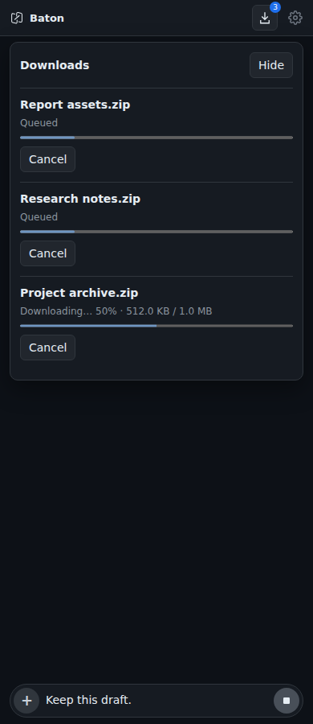
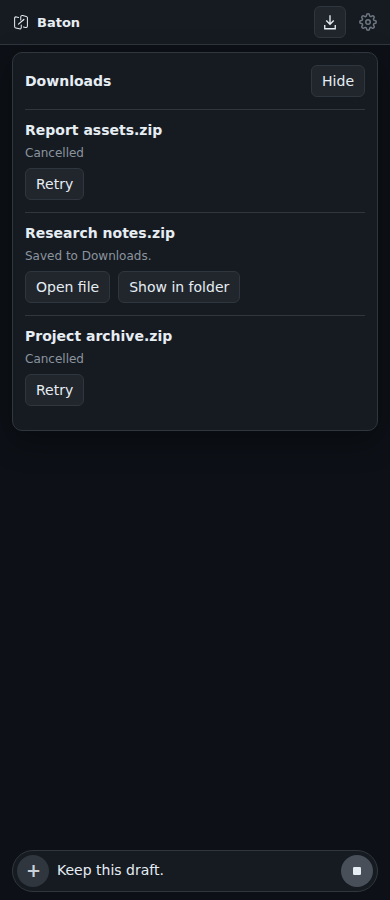

# Project download queue

The file preview's Download action adds an independent task. Closing a preview or moving to another project does not stop accepted tasks. The Downloads button reopens their status panel; retries go behind existing work. Pending tasks and receipts live in the current WebView, not in persistent history.

## Preparation and ownership

Each task captures server, account, device, project, path and name. A retry cannot run against a different account. Signed-URL requests use the captured credentials; these stay in memory and never enter the WebSocket payload. Local project downloads prepare their own file instead of sharing the preview's cached promise.

The existing `project_files` route gains `cancel_download` and an optional UUID `downloadToken`. Server stamps `downloadOwner` from the authenticated account; Bridge keys cancellation by owner plus token, including reconnects and cancellation before preparation arrives. Cancellation stops hashing, file preparation and upload, then acknowledges cleanup. A missing acknowledgement is reported as unconfirmed, not cancelled. Preparation has an independent five-minute deadline. Legacy downloads without tokens remain supported.

**Frontend, Bridge and Server must be updated together for cancellable preparation.** No deployment is part of this contribution.

## Saving

- Desktop: HTTPS streaming into a reserved Downloads file, progress, cancellation and partial-file cleanup. Saved receipts belong to the originating WebView. Mac supports Open/Reveal; Linux uses the default file/folder opener. Those actions are hidden on Windows.
- Android: DownloadManager progress, cancellation, saved receipts, Open file and system Downloads. Completion no longer automatically opens the share sheet. Downloads already handed to Android may continue if the app is destroyed.
- iOS: URLSession progress and cancellation, followed by the existing system share sheet; temporary files are removed afterwards. No persistent receipt/open-location action is claimed.
- Browser: signed URLs go to browser Downloads without buffering; use the browser's own progress/cancel controls after handoff. Mobile file sharing buffers at most 50 MB and waits for a fresh Share click.

Native downloads are limited to 512 MB. Unknown totals show indeterminate progress. A confirmed completed save wins a concurrent cancellation rather than falsely claiming that the file disappeared.

## Verification and review gates

Frontend regression and browser interaction evidence covers serial execution, cancellation acknowledgement, retries, scope changes, preview closure, navigation restoration, receipt actions and draft preservation. Screenshots use the actual browser/viewer/queue with simulated native IPC; they are not device screenshots.

Portable Rust tests use actual local TCP transfers to check socket closure, cleanup, size/length errors, binary integrity, timeouts and receipt ownership. Android plugin compilation and request-history tests are separate from device acceptance.

Validated on this contribution: frontend 619 passed / 1 existing skip; packaging 31 passed; Vite build passed. The shared native core passed 17 portable Rust transfer/receipt tests, 4 Rust local-image tests and 13 Android unit tests, including command routing, failed writes, cancellation and cleanup. The unchanged preparation foundation previously passed Bridge 302 and Server 145 tests.

The combined queue, image-save, Mermaid-export and Android Back branch passed 635 frontend tests / 1 existing skip, packaging 31 and Vite. A complete ARM64 Android debug APK of that combined implementation was built with disposable test signing; its signature, plugin commands, Back hook and bundled frontend were checked. It was not installed. All six pairwise contribution merges are conflict-free; this is separate from the combined runtime checks.

Mac/iOS native builds and real device saves, cancellation, sharing, legacy Android permission handling and file opening remain review gates. The queue now shares an identical native saving core with the image-save and Mermaid-export PRs, including bounded local image writes. Their combined browser interaction has been checked alongside Android Back; Back dismisses the queue panel first. This PR does not import the separate image or Mermaid UI, Lab branding, themes, native tabs or deployment files.

The file-viewer module imports the queue stylesheet explicitly, including when loaded lazily. Browser verification checks the fixed panel position, list padding and viewport bounds; checking only for horizontal overflow does not establish that the stylesheet loaded.
