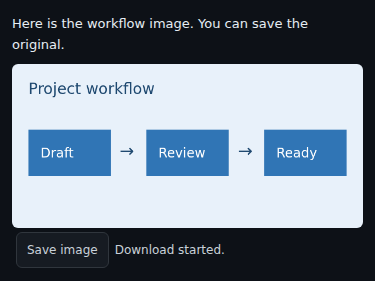
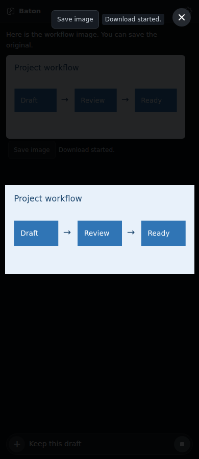

# Save chat images

Loaded chat images have a **Save image** button. The shared full-screen image
viewer has the same action beside its close button. Saving keeps the original
image bytes rather than taking a screenshot or recompressing a canvas.





These screenshots show Chromium and actual browser downloads with synthetic
image content. They are not native device screenshots.

## Behavior

- Save acts on the image selected when clicked. Changing the current image
  during a save does not substitute another image or label it as already saved.
- Double-clicks on a busy action are ignored. Failures remain visible and the
  action can be retried. Cancelling an OS share sheet is not reported as a save.
- Saving does not close the viewer, send a message or modify the text draft.
  Stale inline controls from another conversation cannot initiate a save.
- Unloaded project images retain their existing load/permission flow. A save
  control appears after the image is loaded; it does not read a project path.
- Desktop native saves use Downloads; Android uses the existing download
  plugin's destination; iOS opens the existing share sheet. A browser reports
  that a download started, since it cannot confirm the user's final destination.

## Sources and limits

Local data and cached Blob sources use the shared local-image download support
also used by Mermaid export. Supported local formats are base64 PNG, JPEG, GIF,
WebP and SVG, up to 32 MiB. Bytes are preserved; a recognized raster signature
corrects a mismatched declared type and filename extension.

Native HTTPS sources use the existing plugin's network download path and its
limits. Browser HTTPS sources must allow a CORS read; they are read with a
32 MiB bound before a local download starts. CORS errors are displayed rather
than silently navigating away. File URLs, arbitrary schemes and embedded URL
credentials are rejected.

The native saving core, tests and browser download handling are identical across
the Mermaid export, image saving and download queue contributions. Each contribution can be reviewed
on its own; after any one is merged, those shared changes need only be retained
once.

## Validation and native acceptance

Frontend tests cover original bytes/names, duplicate clicks, retry/cancellation,
draft preservation, conversation changes, changed full-screen selection,
cached Blob input, bounded reads and controls restored after streaming updates.
Chromium at 390px and 1180px actually downloads chat, full-screen and cached
images and compares the result byte-for-byte.

```sh
npm ci
npm ci --prefix bridge
node --test test/frontend/image-save.test.mjs
npm run build
cargo test --manifest-path test/native/local-image/Cargo.toml --locked
```

Mac/iOS builds and native save acceptance remain required. On each supported
native platform, save an inline image and a full-screen image, check the actual
file/share result, retry a failure, cancel where supported, and verify that the
viewer gestures, close button and draft still work. Include cached images and
HTTPS originals. Automated browser checks do not verify Downloads, MediaStore
or the iOS share sheet.

The shared native core includes cancellable image writes and saved receipts. A combined browser check with Mermaid export, the project queue and Android Back also preserves the original PNG bytes and the draft. This contribution keeps its own image controls; it does not import the queue or Mermaid UI. Mac/iOS builds and native device acceptance remain required. A combined ARM64 Android debug APK compiled successfully; it has not been installed.
