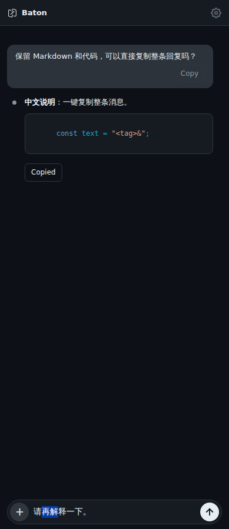
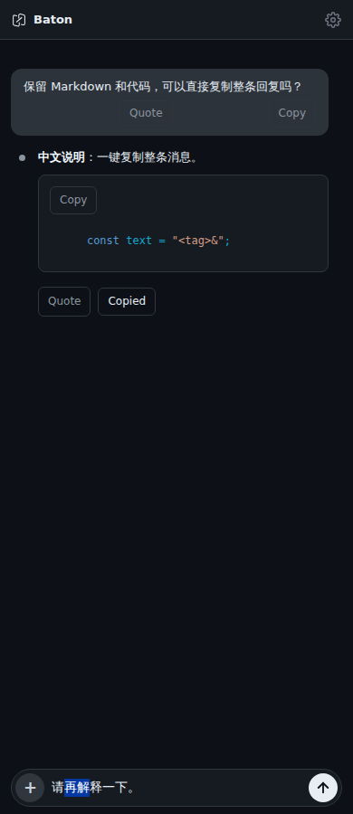

# Copy a message

User text and assistant replies have a **Copy** button. Assistant replies copy
their original Markdown, including code fences, indentation and links. User
messages copy their text without timestamps, attachment labels or controls.
Text blocks belonging to one source message are joined with a blank line;
tool output, thinking, summaries and image-only messages are excluded.

While a reply streams, only the revealed text is available. Before the source
message ID is confirmed, provisional blocks have separate controls; once
confirmed, they regroup into one message control. IDs are scoped to their
turn so reused block or native IDs do not combine unrelated replies.

Copy never sends a message or edits the composer. Pointer clicks preserve
the current draft, focus and selection; keyboard activation also works.
Clipboard success shows **Copied**. Denied or unavailable clipboard access
shows **Copy failed** and can be retried. Repeated clicks during a pending write
share one operation, and late feedback cannot change a replacement conversation.

## Implementation

`message-text.js` provides the same source extraction and grouping used by
the independent Quote contribution. History preserves source in an escaped
`data-message-text` attribute; the reveal renderer updates it to the visible
prefix. Using one attribute avoids stale streaming properties after history
reconciliation. Read-only sessions can copy text.

The `.message-action` marker excludes Copy/Quote/code controls from message
identity and content comparisons. A history refresh therefore preserves
unchanged message nodes and their controls while still applying real text
updates. It does not exclude message text from comparison.

This uses the browser/WebView Clipboard API, with no native plugin, dependency,
Bridge or Server change. This contribution is separate from Quote and code-block
Copy; the latter copies the rendered code block, while this copies the original
message Markdown.

## Screenshots and validation

Actual Chromium with synthetic messages, not native-device captures.

With the independent Quote and code-block Copy contributions also merged:

Frontend: 616 passed, one existing skip; packaging: 31 passed; Vite build passed.

Fourteen focused tests cover source escaping and CRLF, grouping and turn isolation,
revealed Unicode, history replacement, draft preservation, clipboard
failure/retry, pending writes, identity confirmation and DOM reconciliation.
The same reconciliation tests fail against the original DOM updater and pass
with the change.

Actual Chromium at 390px and 1180px verifies clipboard read-back for user text,
original Markdown/tabs, multiple text blocks and revealed Unicode, plus
failure/retry, keyboard Enter, draft/caret preservation and history node
identity. No page errors or page-width overflow. Native Android/iOS/macOS
WebView clipboard and soft-keyboard behavior have not been independently
verified.
