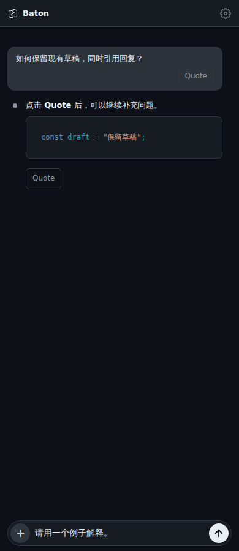
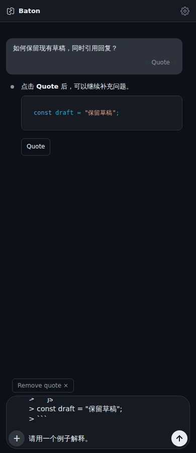

# Quote a message

Select **Quote** below a user or assistant message to put its text at the beginning of the current draft. Markdown and code in assistant replies are preserved. Add your question and use the normal Send button when ready; quoting never sends automatically.

Selecting another message replaces the unedited quote and keeps the rest of the draft. **Remove quote** removes that inserted text. If you edit the quoted text itself, it becomes ordinary draft text and the remove button disappears. After a page reload it is also ordinary saved draft text.

Tool output, thinking, attachments and command panels are excluded. While a reply is streaming, Quote captures only the text already revealed. The control is scoped to the active conversation; read-only threads and disabled composers cannot be changed.

Source extraction is shared in `message-text.js` with the independent whole-message Copy contribution. History and streaming use the same `data-message-text` attribute, preserving original Markdown, tabs and CRLF without retaining stale streaming properties. Multiple blocks regroup when the source message ID is confirmed; IDs reused in different turns remain separate.

Quote buttons use the `.message-action` marker so history reconciliation ignores the control when comparing message content. This preserves unchanged message nodes and still applies actual text updates. Quote and Copy can appear side by side.

These are real 390px Chromium screenshots using synthetic conversation content, before and after Quote. The textarea scrolls to the preserved draft for continued editing. They are browser evidence, not native-device screenshots.

| Before | After |
| --- | --- |
|  |  |

Validation after the shared-source update: 618 frontend tests passed with one existing skip, 31 packaging tests and Vite build passed. Sixteen focused tests cover Quote, source extraction and DOM reconciliation. Actual 390px/1180px Chromium checks pass; native keyboard behavior remains unverified for this PR.
